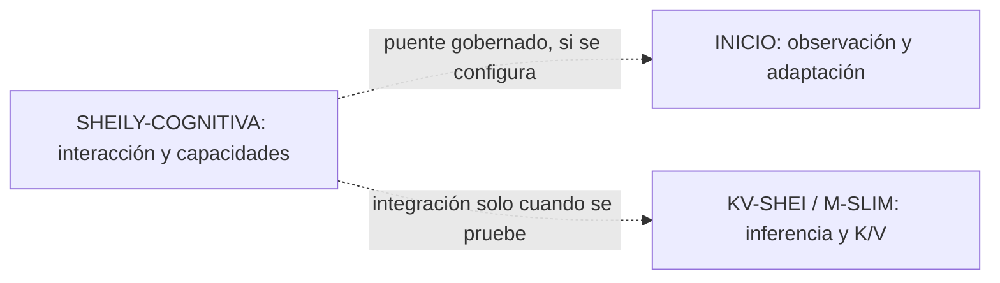

# Sheily-AI · guía de la organización

Este repositorio mantiene la [portada pública de Sheily-AI](profile/README.md) y sirve como índice de sus proyectos. La [Wiki de la organización](https://github.com/Sheily-AI/.github/wiki) ofrece una vista de navegación; el código y la documentación versionada de cada proyecto son sus fuentes técnicas.

## Índice

- [Mapa de proyectos](#mapa-de-proyectos)
- [Cómo se relacionan](#cómo-se-relacionan)
- [Dependencias mantenidas](#dependencias-mantenidas)
- [Dónde comprobar capacidades y estado](#dónde-comprobar-capacidades-y-estado)
- [Acceso y colaboración](#acceso-y-colaboración)
- [Mantenimiento de esta portada](#mantenimiento-de-esta-portada)

## Mapa de proyectos

| Proyecto | Responsabilidad | Puerta de entrada |
| --- | --- | --- |
| [SHEILY-COGNITIVA](https://github.com/Sheily-AI/SHEILY-COGNITIVA) | Sistema cognitivo modular en Rust: interacción, capacidades, inferencia, memoria y gobernanza. | Su README y la documentación de arquitectura y operación. |
| [KV-SHEI](https://github.com/Sheily-AI/KV-SHEI) | Arquitectura de inferencia y memoria K/V; M-SLIM es el runtime local que ejecuta modelos y conserva continuidad física. | Su README, catálogo de capacidades y contratos de validación. |
| [INICIO](https://github.com/Sheily-AI/INICIO) | Runtime adaptativo en Python: observación, aprendizaje admitido y cambios estructurales gobernados con evidencia. | Su README, mapa documental y contratos de adaptación. |

Los tres repositorios son distintos. La presencia de una capacidad en uno no implica que esté integrada, activada o desplegada en los otros.

## Cómo se relacionan

SHEILY-COGNITIVA gobierna la interacción y las capacidades de su propio producto. INICIO conserva su runtime y autoridad de adaptación; cualquier puente con SHEILY necesita configuración, identidad y evidencia propias. KV-SHEI/M-SLIM ejecuta inferencia y administra K/V bajo sus contratos. Este mapa describe responsabilidades, no una certificación de una instalación concreta.

## Dependencias mantenidas

| Repositorio | Uso |
| --- | --- |
| [KV-SHEI-tch-rs](https://github.com/Sheily-AI/KV-SHEI-tch-rs) | Fork de tch/torch-sys para el backend LibTorch opcional de KV-SHEI. |
| [KV-SHEI-tokenizador-rust](https://github.com/Sheily-AI/KV-SHEI-tokenizador-rust) | Fork mantenido de tokenizers para KV-SHEI. |

Cada fork documenta su base upstream, cambio mantenido, validación y límites. No se debe interpretar como un producto independiente ni como una actualización automática de KV-SHEI.

## Dónde comprobar capacidades y estado

1. **Fuente y contrato:** README, código y documentación versionada del repositorio pertinente.
2. **Validación:** pruebas y matrices correspondientes a la misma revisión y configuración.
3. **Operación:** artefacto instalado, configuración efectiva, servicio y petición real cuando la afirmación sea sobre funcionamiento residente.
4. **Rendimiento:** mediciones físicas comparables, con modelo, hardware y método identificados.

Una página de presentación, un manifiesto, un test aislado o un proceso vivo no sustituyen esas comprobaciones. Los estados observados en documentos pueden caducar; comprueba su fecha y la identidad que enlazan.

## Acceso y colaboración

Este repositorio `.github` y su Wiki son públicos. Los cinco repositorios enlazados arriba son privados actualmente: los enlaces exigen permiso y esta página no publica su código. Los Issues y Pull requests de cada trabajo se gestionan en el repositorio que lo posee.

## Mantenimiento de esta portada

- [`profile/README.md`](profile/README.md) es la portada visible en la página principal de la organización.
- [`scripts/generate_profile.py`](scripts/generate_profile.py) actualiza la región automática usando la lista pública deliberada de [`profile/catalog.json`](profile/catalog.json); no lee ni publica código privado.
- El workflow `Update organization profile` comprueba cambios cada hora, puede ejecutarse manualmente y acepta el evento `project-changed` para integraciones inmediatas.
- Este `README.md` explica el mapa y las reglas de lectura dentro del repositorio `.github`.
- La [Wiki](https://github.com/Sheily-AI/.github/wiki) ayuda a navegar, pero no reemplaza la documentación técnica canónica.
- Cuando cambie la organización de los proyectos, actualiza juntos los nombres, enlaces, límites de acceso y descripciones; no conviertas propuestas o pruebas en hechos de producción.

<!-- SHEILY_CODE_REALITY_START -->
## Observed technical state

- Local branch: main
- Observed SHA: 36a1afe4cf29
- Working tree: clean
- Code / tests detected: 0 / 0
- GitHub Actions workflows: 2
- Execution entrypoints/surfaces: 0

Details are generated from the code rather than manual claims:
- docs/CODE_REALITY.md
- docs/EXECUTION_FLOWS.md
- docs/CI_OPERATIONS.md

This section is an observed snapshot, not a production certification.
<!-- SHEILY_CODE_REALITY_END -->
